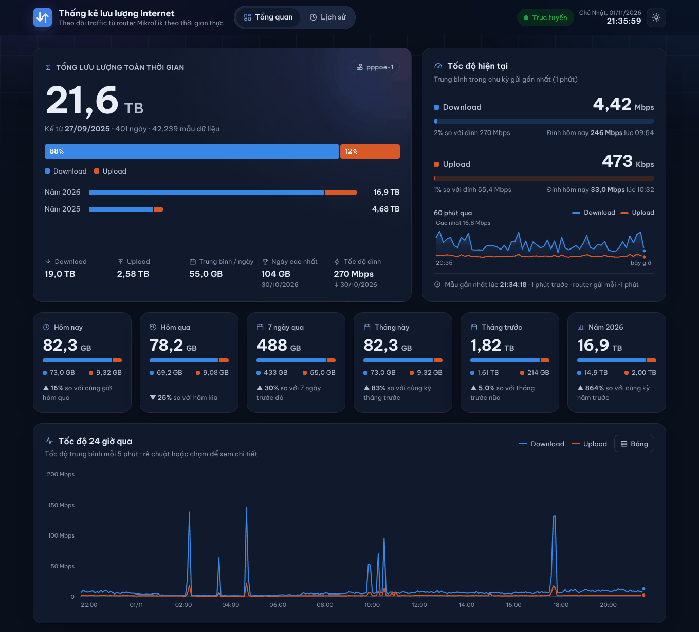
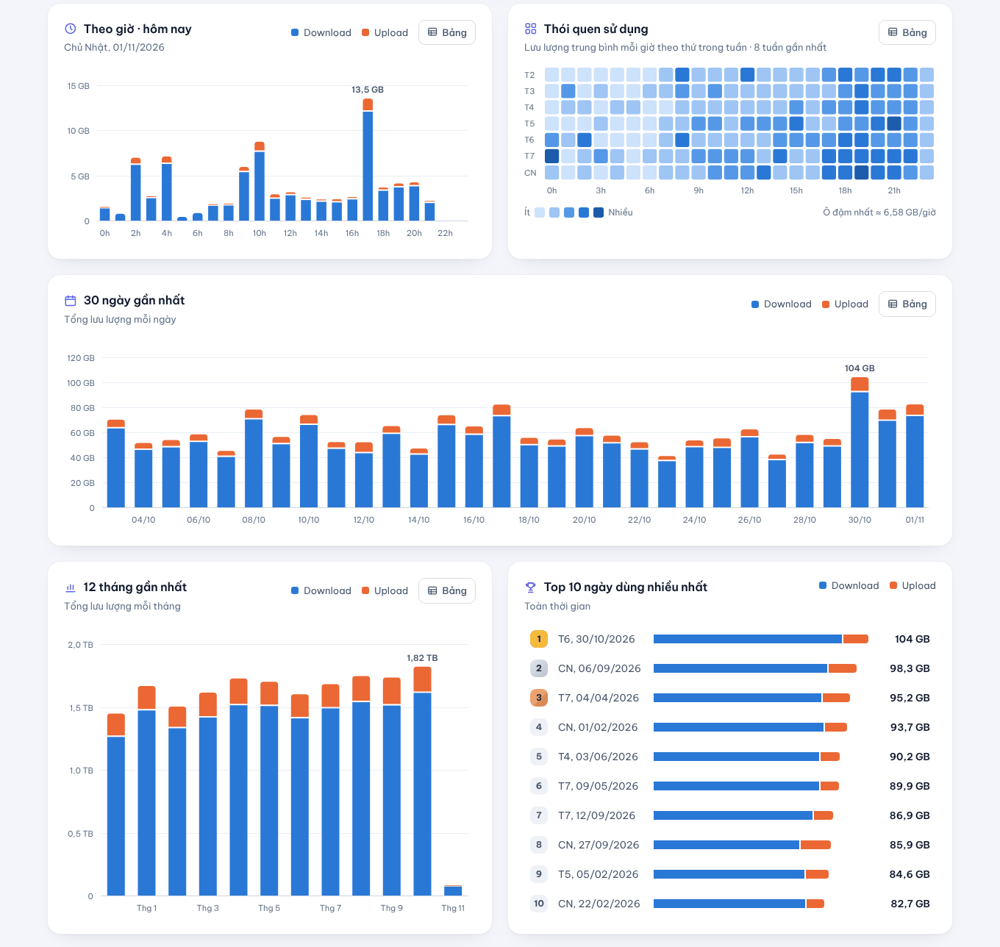
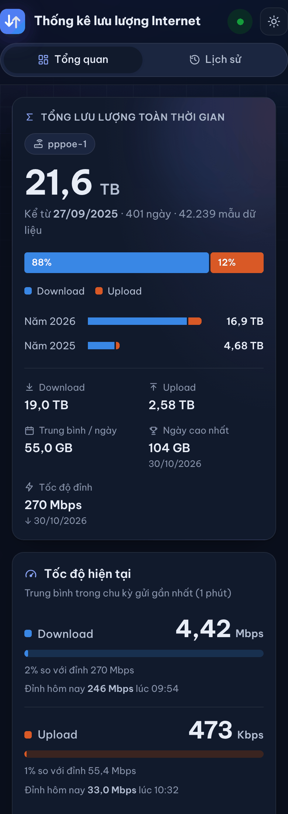

# Net Traffic — Thống kê lưu lượng Internet từ MikroTik

Trang web PHP hiển thị và thống kê traffic Internet do router **MikroTik** gửi về.
Gọn nhẹ cho **shared hosting**: không cần Composer, không cần cron, không cần MySQL —
toàn bộ dữ liệu nằm trong **một file SQLite** duy nhất.



<table>
  <tr>
    <td width="72%"></td>
    <td width="28%"></td>
  </tr>
</table>

<sub>Ảnh minh họa với dữ liệu mẫu.</sub>

## Tính năng

- **Tổng lưu lượng toàn thời gian** (Download/Upload, tỉ lệ, theo từng năm, trung bình/ngày, ngày cao nhất, tốc độ đỉnh).
- **Tốc độ hiện tại** kèm thang đo theo gói cước và biểu đồ **60 phút qua**, trạng thái router *Trực tuyến / Mất tín hiệu*.
- Thẻ **Hôm nay, Hôm qua, 7 ngày, Tháng này, Tháng trước, Năm nay**, mỗi thẻ có so sánh với kỳ trước
  (ví dụ: hôm nay so với *cùng giờ* hôm qua).
- Biểu đồ **tốc độ 24 giờ**, **theo giờ hôm nay**, **30 ngày**, **12 tháng**, **bản đồ nhiệt thói quen** (thứ × giờ),
  **lịch sử dụng 12 tháng**, **Top 10 ngày** dùng nhiều nhất, **nhật ký mẫu** router gửi gần đây.
- Trang **Lịch sử**: chọn nhanh (hôm nay, 7/30 ngày, tháng, năm, toàn bộ) hoặc khoảng ngày tùy ý,
  tự chọn biểu đồ theo giờ/ngày/tháng/năm, bảng chi tiết và **xuất CSV**.
- Giao diện **sáng/tối** (tự theo thiết bị), responsive trên điện thoại, có hiệu ứng nhẹ.
  Mọi biểu đồ có tooltip, xem được bằng bàn phím và có nút **Bảng** để xem số liệu dạng bảng.
- Tự làm mới trang mà không cần tải lại (chỉ tải khi có dữ liệu mới, tạm dừng khi tab bị ẩn).
- Toàn bộ thời gian theo **giờ Việt Nam (GMT+7)**, số theo kiểu Việt Nam (`1.234,56 GB`).
- **Trang quản trị**: đổi **tên trang web**, dòng mô tả, **footer**, nhãn kết nối, giao diện mặc định, đơn vị 1024/1000,
  băng thông gói cước, chu kỳ tự làm mới, chế độ riêng tư, khóa bảo mật cho `log.php`, thời gian giữ dữ liệu chi tiết,
  xuất CSV, tối ưu/xóa dữ liệu, đổi mật khẩu.

## Yêu cầu

- PHP **7.4 trở lên** (đã thử trên PHP 8.3) có bật `pdo_sqlite` — gần như hosting nào cũng có sẵn.
- Apache hoặc LiteSpeed (đọc được `.htaccess`). Dùng Nginx thì xem phần [Nginx](#nginx).

## Cài đặt

1. Tải toàn bộ thư mục lên hosting, ví dụ vào `public_html/linh-tinh/net-traffic/`
   để có địa chỉ `https://tools.tuantuit.io.vn/linh-tinh/net-traffic/`.
2. Đảm bảo PHP **ghi được** vào thư mục `data/` (thường mặc định đã được; nếu báo lỗi thì chmod `755`, hoặc `775`/`777` tùy hosting).
3. Mở `admin.php` để **tạo tài khoản quản trị** (làm ngay sau khi upload), đặt tên trang, footer…
4. Router vẫn gửi về `log.php` như cũ — số liệu sẽ xuất hiện ngay ở trang chủ.

File dữ liệu `data/traffic.sqlite` được tự tạo ở lần chạy đầu tiên.

## Cấu hình router MikroTik

### Script hiện tại của bạn — vẫn dùng được, không cần sửa

`log.php` nhận đúng định dạng cũ `log.php?rx=<byte>&tx=<byte>` (lượng byte phát sinh kể từ lần gửi trước).
Giá trị âm (bộ đếm router bị reset khi PPPoE quay số lại hoặc router khởi động lại) được tính là 0.
Nếu muốn không mất phần dữ liệu đó, thêm 2 dòng sau ngay trước dòng `:local diffRx`:

```
:if ($curRx < $rxLast) do={ :set rxLast 0 }
:if ($curTx < $txLast) do={ :set txLast 0 }
```

### Script cải tiến (khuyên dùng)

Gửi thẳng bộ đếm `rx-byte`/`tx-byte` của interface, server tự tính chênh lệch nên:
không mất số liệu khi PPPoE quay số lại hay router khởi động lại, gửi lỗi hay gửi trùng cũng không bị đếm sai,
không cần biến global.

```
:local iface "pppoe-1"
:local url "https://tools.tuantuit.io.vn/linh-tinh/net-traffic/log.php"

:local rxc [/interface get $iface rx-byte]
:local txc [/interface get $iface tx-byte]
:local upt [/system resource get uptime]

/tool fetch url=($url . "?rxc=$rxc&txc=$txc&up=$upt") keep-result=no
```

Dòng `upt` (uptime của router) là tùy chọn nhưng nên có: nhờ nó server biết chính xác lúc router khởi động lại,
nên sau khi router tắt lâu, lượng dữ liệu được ghi đúng vào khoảng thời gian router thực sự chạy.

Lần gửi đầu tiên ở chế độ này chỉ ghi mốc bộ đếm (0 byte), từ lần sau số liệu được tính bình thường.
**Chỉ chạy một trong hai script.** Trang *Quản trị › Router MikroTik* hiển thị sẵn cả hai script với
đúng địa chỉ trang của bạn và khóa bảo mật (nếu có), chỉ cần bấm *Sao chép*.

### Chạy định kỳ

Tạo script tên `net-traffic` (quyền `read, write, policy, test`) rồi thêm lịch chạy mỗi phút:

```
/system scheduler add name=net-traffic interval=1m on-event="/system script run net-traffic" policy=read,write,policy,test
```

Chu kỳ nào cũng được (30 giây, 1 phút, 5 phút…), trang tự nhận biết chu kỳ để tính tốc độ.

### Tham số của `log.php`

| Tham số | Ý nghĩa |
|---|---|
| `rx`, `tx` | Byte download/upload phát sinh kể từ lần gửi trước (script cũ) |
| `rxc`, `txc` | Bộ đếm `rx-byte`/`tx-byte` hiện tại của interface (script cải tiến) |
| `up` | Uptime của router, ví dụ `2d03:04:05` hoặc `2d3h4m5s` (tùy chọn, đi kèm `rxc`/`txc`) |
| `key` | Khóa bảo mật — bắt buộc nếu admin đã đặt khóa |

Nhận cả GET và POST. Trả về `OK` (HTTP 200) khi ghi thành công; `400` nếu tham số sai, `403` nếu sai khóa.
Trên interface PPPoE client, `rx` = download, `tx` = upload.

## Quản trị

- **Tên trang, mô tả, footer**: footer là văn bản thường, hỗ trợ `{year}` (năm hiện tại),
  `[chữ](https://link)` (liên kết), link `https://…` tự nhận, `**chữ đậm**` và xuống dòng. HTML bị chặn để an toàn.
- **Khóa bảo mật**: khi đặt khóa, mọi yêu cầu tới `log.php` phải kèm `&key=…`, tránh người lạ gửi số liệu giả.
  Nhớ cập nhật script trên router ngay sau khi lưu.
- **Chế độ riêng tư**: phải đăng nhập mới xem được thống kê.
- **Quên mật khẩu**: mở `config.php`, đặt `ALLOW_ADMIN_RESET` thành `true`, vào `admin.php` tạo tài khoản mới
  (dữ liệu được giữ nguyên), sau đó đặt lại thành `false`.

Đăng nhập không dùng PHP session (tránh lỗi session trên shared hosting) mà dùng cookie ký HMAC;
có chống CSRF và tạm khóa 15 phút sau 5 lần nhập sai mật khẩu.

## Dữ liệu & sao lưu

Mọi thứ nằm trong **một file**: `data/traffic.sqlite`.

| Bảng | Nội dung | Thời gian giữ |
|---|---|---|
| `samples` | Từng mẫu router gửi lên (dùng cho biểu đồ tốc độ) | 30 ngày (chỉnh được) |
| `hourly`, `daily` | Tổng hợp theo giờ và theo ngày | Vĩnh viễn |
| `settings`, `meta` | Cài đặt, tài khoản quản trị, trạng thái | — |

- Dữ liệu cũ được dọn tự động mỗi ngày một lần khi router gửi dữ liệu — **không cần cron**.
- Gửi mỗi phút ≈ 1.440 mẫu/ngày; với 30 ngày giữ mẫu chi tiết, file thường chỉ vài MB.
- **Sao lưu**: tải file `data/traffic.sqlite` qua File Manager/FTP (file đã bị chặn tải từ web).
  Có thể xuất CSV trong *Quản trị › Dữ liệu*.
- Nếu một lần gửi trải qua nhiều giờ (ví dụ server tạm mất kết nối, script cũ gửi dồn), lượng byte được
  chia đều theo thời gian vào từng giờ nên biểu đồ không bị "gai" và tổng luôn chính xác.
- Có thể đặt file dữ liệu ra ngoài `public_html` bằng cách sửa `DB_PATH` trong `config.php`.

## Bảo mật

- `data/` và `inc/` có `.htaccess` chặn truy cập; `.htaccess` gốc chặn tải các file `.sqlite`, `.md`, `.rsc`…
- Mọi dữ liệu hiển thị đều được escape; tooltip biểu đồ dùng `textContent`.
- Cookie đăng nhập `HttpOnly`, `SameSite=Lax`, `Secure` khi chạy HTTPS.

### Nginx

Nginx không đọc `.htaccess`, hãy thêm vào cấu hình site (sửa đường dẫn cho đúng):

```nginx
location ^~ /linh-tinh/net-traffic/data/ { deny all; }
location ^~ /linh-tinh/net-traffic/inc/  { deny all; }
location ~* \.(sqlite|sqlite3|db|md|rsc)$ { deny all; }
```

## Cấu trúc thư mục

```
├── index.php        Trang Tổng quan + Lịch sử
├── log.php          Endpoint nhận dữ liệu từ router
├── api.php          JSON tự làm mới + xuất CSV
├── admin.php        Trang quản trị
├── config.php       Múi giờ, đường dẫn file SQLite, khôi phục mật khẩu
├── inc/             Mã PHP dùng chung (CSDL, thống kê, giao diện, đăng nhập)
├── assets/          app.css, app.js (biểu đồ SVG tự viết, không dùng thư viện ngoài), favicon
└── data/            traffic.sqlite (tự tạo)
```

## Câu hỏi thường gặp

**Lỗi 500 ngay khi mở trang?** Một số hosting không cho dùng `Options` trong `.htaccess` —
xóa dòng `Options -Indexes` ở file `.htaccess` gốc. Nếu trang báo không ghi được dữ liệu,
kiểm tra quyền ghi của thư mục `data/`.

**Số liệu hơi khác Winbox?** Winbox dùng 1 KB = 1024 byte; nhà mạng thường dùng 1000.
Chọn đơn vị trong *Quản trị › Cài đặt chung*. Tốc độ luôn tính theo bit/giây (1 Mbps = 1.000.000 bit/s).

**Router tắt lâu (mất điện, rút nguồn) thì số liệu có chính xác không?** Có, với script cải tiến:
- Trong lúc router tắt không có traffic nào đi qua nên không có gì để đếm; biểu đồ tốc độ để trống khoảng đó.
- Khi bật lại, bộ đếm của router bắt đầu từ 0. Server tự nhận ra và tính đủ toàn bộ lượng dữ liệu từ lúc bật,
  ghi vào đúng thời điểm router chạy lại (không rải lên những giờ router đang tắt, không bị tính sang ngày hôm trước).
  Có gửi kèm uptime thì thời điểm này chính xác tuyệt đối; không có thì server ước lượng bằng 2 chu kỳ gửi gần nhất.
- Chỉ mất phần phát sinh từ lần gửi cuối tới lúc tắt (tối đa 1 chu kỳ, ví dụ dưới 1 phút) vì router chưa kịp gửi
  và bộ đếm mất khi tắt nguồn.
- Nếu router vẫn chạy, vẫn có mạng nhưng không gửi được về hosting (hosting lỗi), lần gửi sau mang theo toàn bộ
  phần còn thiếu và được chia đều theo thời gian vào từng giờ, tổng không mất.
- Mất mạng (nhà mạng sự cố) cũng giống router tắt: không có traffic, khi có mạng lại số liệu được tính tiếp bình thường.

**"Tốc độ hiện tại" là gì?** Là tốc độ trung bình trong chu kỳ gửi gần nhất (ví dụ 1 phút), không phải tốc độ tức thời.

**Đổi múi giờ được không?** Mặc định `Asia/Ho_Chi_Minh` trong `config.php`. Không nên đổi khi đã có dữ liệu
vì các mốc giờ/ngày đã được gom sẵn theo múi giờ cũ.
